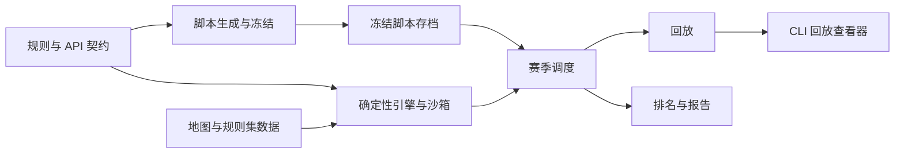

# v0 交付拓扑

本图说明 v0 交付物的主要依赖与边界。箭头表示交付物之间的输入关系；包依赖与进程模型归 [HLD](../hld.md)，玩法意图归 [GDD](../gdd.md)，定位与非目标归 [vision](../vision.md)，验收落点归 [HLD §11](../hld.md)。

## 交付边界与设计入口

| 边界 | 长期入口 |
|---|---|
| M1 规则与契约 | [GDD](../gdd.md) 定义设计意图与约束；[规则集](../../rulesets/) 持有参数取值；[面向模型的契约](../rules-v2/) 与 [基准脚本](../../benchmarks/) 承接模型可读性验收 |
| M2 对局执行与回放 | [engine](../../packages/engine/) 负责确定性结算与沙箱，[replay](../../packages/replay/) 定义回放格式与解析；确定性、预算和复算方案见 [HLD](../hld.md) |
| M3 脚本生成与冻结 | [gen](../../packages/gen/) 产出参赛脚本存档；生成协议与存档格式见 [HLD](../hld.md) |
| M4 赛季调度与报告 | [runner](../../packages/runner/) 编排对局、排名与报告；[CLI](../../apps/cli/) 提供命令入口，验收落点见 [HLD §11](../hld.md) |

数据形状与共享类型归 [schema](../../packages/schema/)，校验与仓库工具归 [tools](../../packages/tools/)。详细包拓扑以 HLD 为准。

## 相关决策

- [ADR-0003](../adr/0003-schema-single-source-distribution.md)：schema 真源与分发边界。
- [ADR-0001](../adr/0001-sandbox-quickjs-wasi.md) 与 [ADR-0005](../adr/0005-runner-seam-is-the-two-bridge-calls.md)：沙箱选型与执行器接口。
- [ADR-0006](../adr/0006-script-api-type-surface-lands-in-engine.md)：脚本 API 类型面的归属。
- [ADR-0007](../adr/0007-runtime-bundle-artifact-is-committed.md)：运行时产物的入库边界。
- [ADR-0009](../adr/0009-budget-final-values-are-revocable.md)：预算终值的复核与失效条件。
